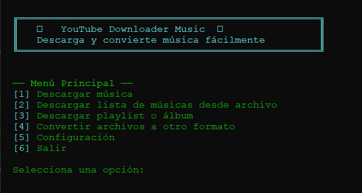

# YouTube Downloader Music

A console application for downloading audio from YouTube and YouTube Music
links, organizing songs and collections, and converting audio files between
formats. The project is written in Python and uses `yt-dlp` for audio
extraction and FFmpeg for conversion and media processing.

> Use the application only with content you have the right to download. The
> user is responsible for respecting copyright and the platforms' terms of use.

## What does it offer?

- Individual audio download to MP3, with a configurable bitrate between 128 and
  320 kbps.
- Download of multiple URLs from a text file, with per-track progress and an
  error report without stopping the rest of the list.
- Download of playlists and albums into their own folder; it also accepts links
  that correspond to a single track.
- Insertion of metadata and cover art when the information is available.
- Batch conversion to MP3, FLAC, WAV, OGG, AAC, M4A, ALAC, or Opus.
- Configuration of folders, bitrate, network timeout, and the maximum number of
  simultaneous fragment downloads.
- Cleanup of temporary files when a download fails or is interrupted.
- Automatic FFmpeg download on the first launch, without having to set it up in
  the `PATH`.
- Compilation as a single-file console executable for Windows.

Converting to a given bitrate cannot recover quality that does not exist in the
original audio.

## Main menu

| Option | Function |
|---|---|
| 1 | Download a song |
| 2 | Download a URL from a text file |
| 3 | Download a playlist or album |
| 4 | Convert audio files |
| 5 | Configure the program |
| 6 | Exit |

## Requirements

### Running from the source code

- Windows 10 or later.
- Python 3.10 or later.
- An internet connection to download FFmpeg on the first launch and to fetch
  content from the platforms.

FFmpeg is downloaded from BtbN FFmpeg-Builds and saved to
`%APPDATA%\YDM-CLI\ffmpeg`. The program checks that the executable works and
reuses the local copy on subsequent launches. Installing FFmpeg manually is not
necessary.

### Running the `.exe`

The end user does not need to install Python or FFmpeg. The executable's first
launch requires an internet connection to download FFmpeg; the functions that
download content require an internet connection.

## Installation and execution from the code

Open PowerShell or the Command Prompt in the folder where you want to keep the
project.

### 1. Get the code

With Git:

```powershell
git clone https://github.com/LK-Ronald/downloader-music.git
cd downloader-music
```

You can also download the repository ZIP and extract it into a folder.

### 2. Create and activate a virtual environment (recommended)

```powershell
python -m venv venv
.\venv\Scripts\Activate.ps1
```

If you use the Command Prompt, activate the environment with:

```cmd
venv\Scripts\activate
```

### 3. Install dependencies

```powershell
python -m pip install -r requirements.txt
```

### 4. Launch the application

```powershell
python main.py
```

On the first launch, FFmpeg will be downloaded automatically. Keep the console
open during the download.

## Usage

### Download a song

Select `1` and paste a YouTube or YouTube Music URL. The file is downloaded as
MP3 into the configured folder. By default, the bitrate is `320k`; you can
change it to `128k`, `192k`, or `256k` in Settings. If the provider offers a
cover, the program tries to crop it to a square format and embed it along with
its metadata.

### Download from a text list

Select `2` and enter the path of the file. You can also use the
`canciones_lista.txt` file included in the project. Write one URL per line;
blank lines and lines starting with `#` are ignored:

```text
# Example list
https://www.youtube.com/watch?v=VIDEO_ID
https://music.youtube.com/watch?v=VIDEO_ID
```

The program processes the URLs in order and continues with the following ones
even if a download fails.

### Download a playlist or album

Select `3` and paste the collection link. The available tracks are saved into a
subfolder named after the playlist or album title. If the link is for a single
song, the program downloads it as an individual track.

### Convert files

Select `4`, enter the source folder and the destination folder, and choose a
format: `mp3`, `flac`, `wav`, `ogg`, `aac`, `m4a`, `alac`, or `opus`. Deleting
the originals is optional and is disabled by default. If a conversion fails, the
corresponding partial file is deleted and the rest of the batch continues.

### Configure options

Select `5` to change the download and conversion directories, the bitrate, the
maximum connection time, or the number of simultaneous fragment downloads. The
download produces MP3; the conversion format selector is in option `4`.

| Setting | Initial value | Range / options |
|---|---:|---|
| Download directory | `~/Music/Downloads` | Configurable path |
| Conversion directory | `~/Music/Converted` | Configurable path |
| Bitrate | `320k` | `128k`, `192k`, `256k`, `320k` |
| Connection timeout | 30 seconds | 5–120 seconds |
| Simultaneous fragment downloads | 4 | 1–8 |

The settings are saved in `~/.ytdl_music_config.json` (on Windows, usually
inside the user profile folder).

## Building the Windows executable

With Python and the project dependencies installed, install PyInstaller and run
the build script:

```powershell
python -m pip install pyinstaller
python build.py
```

The console executable is generated in `dist\YDM-CLI.exe`. FFmpeg is not included
in the `.exe`; each user downloads it on their first launch.

### Rebuild automatically when the code changes

To build once and rebuild when Python files, PowerShell files, or
`requirements.txt` change, run the following from PowerShell in the project
folder:

```powershell
.\watch_build.ps1
```

The watcher builds on startup, waits two seconds of stability after changes, and
updates `dist\YDM-CLI.exe`. It ignores generated folders. To stop it, press
`Ctrl+C`. If the PowerShell execution policy prevents the script from starting,
you can use:

```powershell
powershell -ExecutionPolicy Bypass -File .\watch_build.ps1
```

## Project structure

```text
.
├── main.py
├── build.py
├── watch_build.ps1
├── requirements.txt
├── canciones_lista.txt
├── core/
│   ├── config_manager.py
│   └── menu.py
├── features/
│   ├── downloader.py
│   ├── batch_downloader.py
│   ├── playlist_downloader.py
│   ├── converter.py
│   └── configurator.py
├── utils/
│   ├── ffmpeg_manager.py
│   ├── ffmpeg_process.py
│   ├── ui.py
│   └── ytdlp_wrapper.py
└── tests/
    └── test_ffmpeg_manager.py
```

- `core/` contains the persistent configuration and the navigation menu.
- `features/` contains the actions the user runs from the menu.
- `utils/` includes the integration with `yt-dlp`, FFmpeg management, and the
  console interface.
- `build.py` and `watch_build.ps1` allow creating and updating the executable.

## Troubleshooting

**FFmpeg cannot be downloaded**

Check your internet connection and that GitHub is accessible. FFmpeg is saved in
`%APPDATA%\YDM-CLI\ffmpeg`; it does not need to be added to the `PATH`.

**A YouTube download fails**

Update `yt-dlp` in the active Python environment and try again:

```powershell
python -m pip install --upgrade yt-dlp
```

The platforms may change and require a recent version of `yt-dlp`. Some videos
may not be available, may be private, or may have restrictions.

**A file cannot be converted**

Verify that FFmpeg was downloaded correctly, that the source file is compatible,
and that there is space and write permissions in the destination folder.

## Dependencies and licenses

- [yt-dlp](https://github.com/yt-dlp/yt-dlp): multimedia extraction and download.
- [Mutagen](https://github.com/quodlibet/mutagen): working with audio metadata.
- [Pillow](https://python-pillow.org/): image support.
- [FFmpeg](https://ffmpeg.org/): audio and cover art conversion and processing.
  It is downloaded during execution and is not distributed inside the `.exe`.

This project's code is distributed under the MIT license. The dependencies and
FFmpeg keep their own licenses; check their official projects to learn about
their terms.
